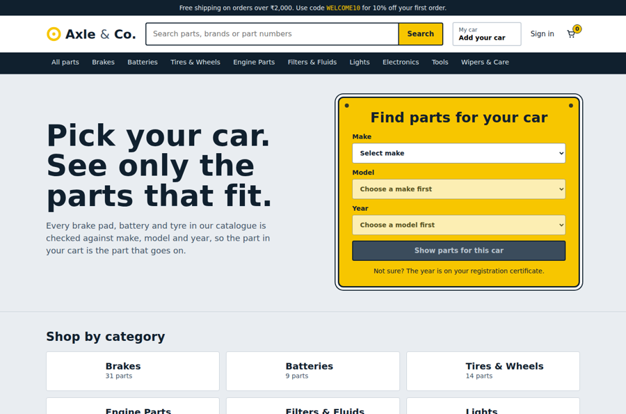

# Axle & Co. — Automotive Parts E-commerce

A full-stack online store for car parts and accessories

Shoppers pick their car (make, model, year) and see only parts that fit. They search, add to a cart that is saved across sessions, pay through a payment gateway and track the order. Store staff manage products, stock, orders, suppliers and promotions from an admin area.

> The catalogue is **demo data**: brands and part numbers are invented. Payments run in a sandbox unless you add Stripe keys.



The full **project report** is in [REPORT.md](REPORT.md).

## Features

| Area | What it does |
|---|---|
| Browse by vehicle | Make → model → year selector; "My car" is remembered and filters the whole store. Each product page says *Fits / Does not fit your car*. Fitment is stored as year ranges, so parts can differ by model generation. |
| Intelligent search | SQLite FTS5 with stemming, prefix matching, a synonym table (tyre→tire, bulb→headlight), part-number and SKU search, ranked results, type-ahead, and a fallback to any-word matching so typos rarely give an empty page. |
| Product information | Specifications, images, ratings and reviews (verified buyers only), compatible-vehicle table, stock level, alternate parts, "customers also bought". |
| Cart | Guests keep a cart in the browser; signed-in carts live on the server and survive logout and other devices. A guest cart merges on sign-in. |
| Checkout | Address validation, standard/express shipping, discount codes, GST, server-side re-pricing, stock reserved during payment. |
| Payments | Built-in sandbox gateway (Luhn, expiry, CVC, declines; only the last four digits are stored) **or** Stripe Checkout when `STRIPE_SECRET_KEY` is set. |
| Emails | Order receipt to the customer, new-order email to the merchant, shipped and cancelled emails. SMTP, or written to `server/outbox/` in development. |
| Accounts | Register / sign in, order history, order tracking timeline, cancel before shipping. |
| Admin | Dashboard (revenue, orders, margin, 14-day chart, best sellers), CSV export, product CRUD with fitment and specs, order fulfilment with tracking numbers, low-stock list, supplier stock-feed import, discount codes. |
| Growth | New arrivals and sale badges, promo codes, `sitemap.xml`, `robots.txt`, Product JSON-LD, per-page titles/descriptions, affiliate links (`?ref=name`) recorded on orders. |

## Quick start

Requires **Node.js 20 or newer** (tested on 22).

```bash
npm run install:all     # installs server and client dependencies
npm run build           # builds the React app into client/dist
npm start               # http://localhost:5000  (seeds the demo catalogue on first run)
```

Open <http://localhost:5000>.

| Role | Email | Password |
|---|---|---|
| Customer | `demo@axleandco.test` | `Demo@1234` |
| Admin | `admin@axleandco.test` | `Admin@123` |

Sandbox cards: `4242 4242 4242 4242` succeeds; `4000 0000 0000 0002` is declined; `4000 0000 0000 9995` has insufficient funds. Use any future expiry and any 3-digit code.

### Development with hot reload

```bash
npm run dev:server      # terminal 1: API on :5000 (restarts on change)
npm run dev:client      # terminal 2: Vite on :5173, proxies /api to :5000
```

Reset the database at any time with `npm run seed`.

## Configuration

Copy `server/.env.example` to `server/.env`. Everything has a development default except `JWT_SECRET`, which is **required when `NODE_ENV=production`**.

To use real card payments: set `STRIPE_SECRET_KEY` (test key `sk_test_…`). For asynchronous confirmation also set `STRIPE_WEBHOOK_SECRET` and point a Stripe webhook for `checkout.session.completed` / `checkout.session.expired` at `/api/webhooks/stripe`.
Amounts are integers in the smallest unit (paise); currency, tax rate and shipping fees are environment variables.

## Tests

```bash
npm test                # 27 API tests (node:test), in-memory database
```

They cover fitment by year, search behaviour, cart persistence and merge, pricing, checkout success/decline/validation, the "last unit" race, order cancel and refund, fulfilment, reviews, admin CRUD and permissions, supplier sync, unpaid-order expiry and the Stripe flow (with a stubbed gateway).

## Project layout

```
server/
  src/app.js            Express app factory (everything injected, so tests use an in-memory DB)
  src/schema.sql        tables, indexes, FTS5 index and triggers
  src/routes/           auth, catalog, cart, orders, admin, seo
  src/services/         search, pricing, payments, orders (lifecycle), mailer, products
  src/seed.js           demo catalogue, vehicles, users, orders, reviews
  tests/                API tests
client/
  src/pages/            Home, Shop, Product, Cart, Checkout, Orders, Auth, admin/*
  src/components/       Header, FitmentPicker, ProductCard, ui
  src/store.jsx         auth, cart, "my car" state
docs/screenshots/       images used in the report
REPORT.md               project report
```

## API overview

Public: `GET /api/categories | vehicles | brands`, `GET /api/products` (q, category, brand, make, model, year, minPrice, maxPrice, inStock, onSale, isNew, sort, page), `GET /api/products/suggest`, `GET /api/products/:skuOrId[/related|/reviews]`, `POST /api/pricing/quote`.
Account: `POST /api/auth/register | login`, `GET|PATCH /api/auth/me`, `GET|PUT|DELETE /api/cart…`, `POST /api/cart/merge`, `POST|GET /api/orders`, `GET /api/orders/:number`, `POST /api/orders/:number/cancel | confirm-payment`, `POST /api/products/:key/reviews`.
Admin (role `admin`): `/api/admin/stats`, `/products`, `/orders`, `/suppliers/:id/sync`, `/coupons`, `/reports/sales.csv`.

## Docker

```bash
docker build -t axle-and-co .
docker run -p 5000:5000 -e JWT_SECRET=$(openssl rand -hex 32) -v axle-data:/data axle-and-co
```

## Pushing to GitHub

```bash
git init && git add . && git commit -m "Axle & Co. automotive parts store"
git branch -M main
git remote add origin https://github.com/<your-username>/axle-and-co.git
git push -u origin main
```

## Troubleshooting

- **`npm install` fails while building `better-sqlite3`:** it is a native module. It needs Python 3 and a C/C++ toolchain if no prebuilt binary matches your Node version (Windows: install "Desktop development with C++" from Visual Studio Build Tools; macOS: `xcode-select --install`; Ubuntu: `sudo apt install build-essential python3`). Using Node 22 LTS gives the best chance of a prebuilt binary.
- **Port already in use:** set `PORT=5001` before `npm start`.
- **Blank styling fonts:** the page loads IBM Plex and Barlow from Google Fonts and falls back to system fonts when offline.
