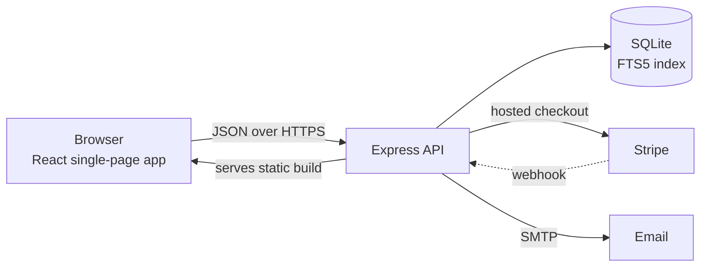
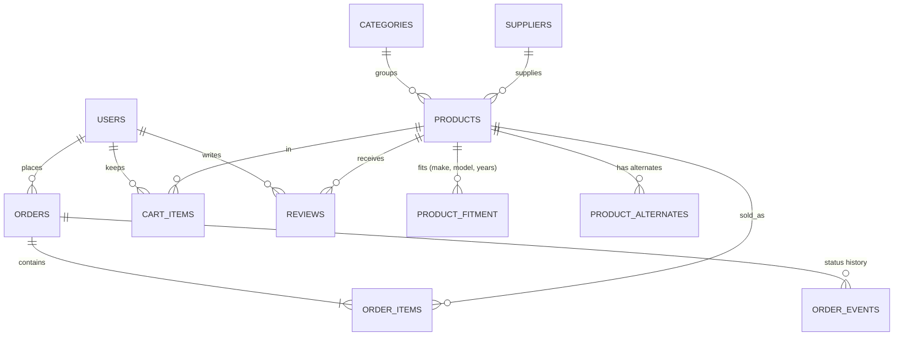
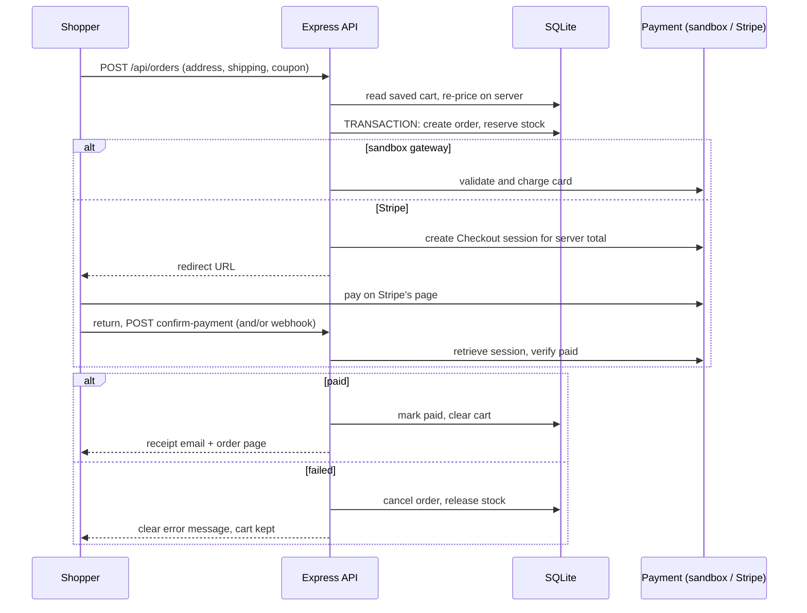
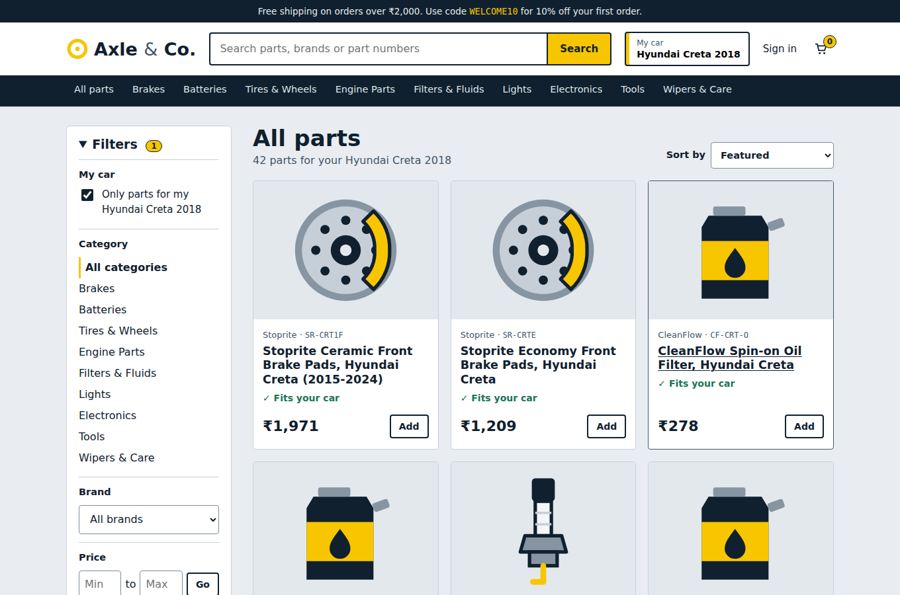
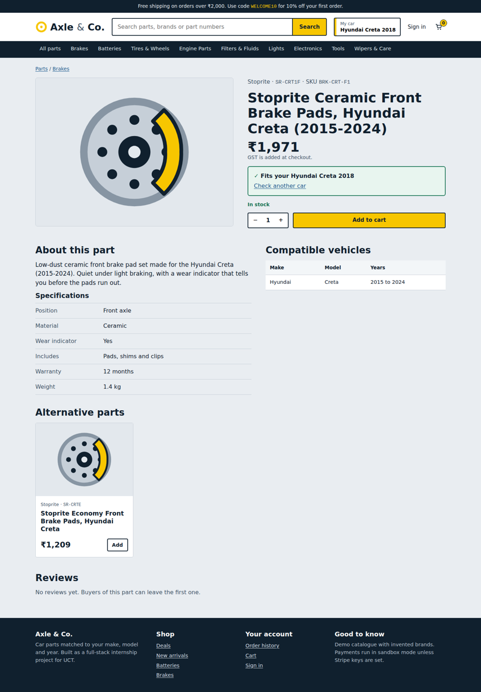
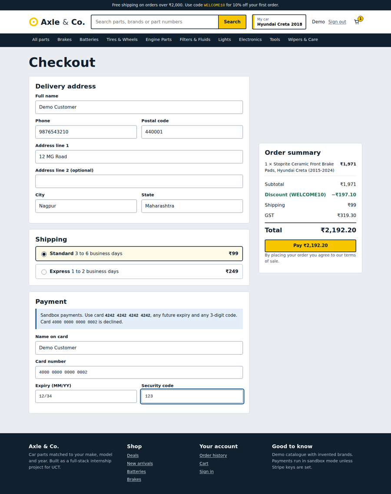
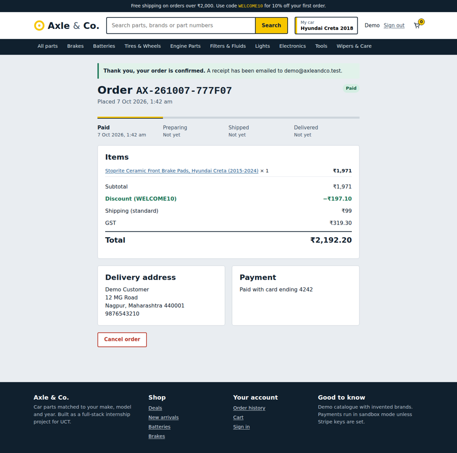
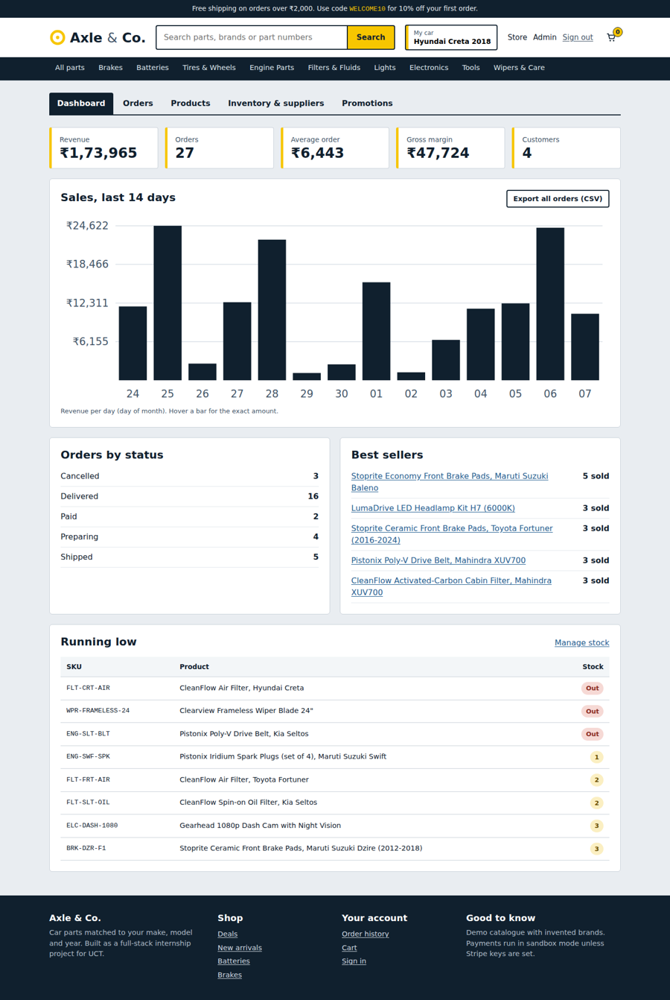
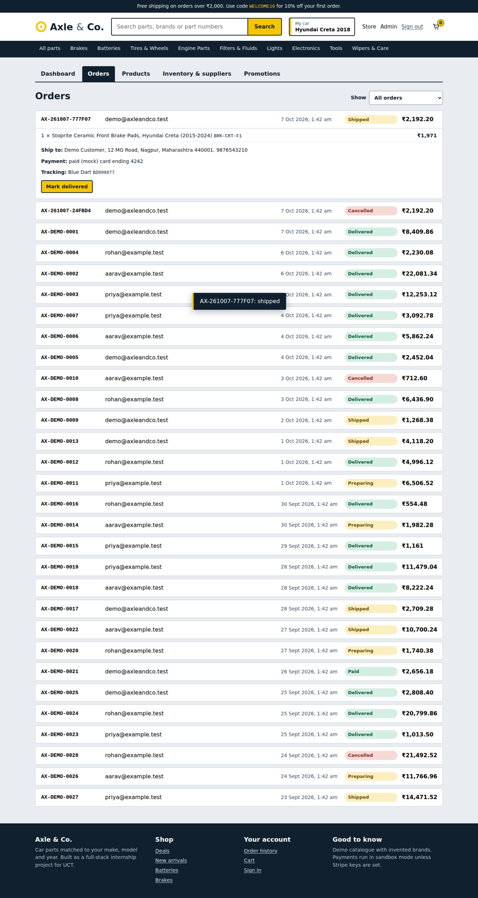
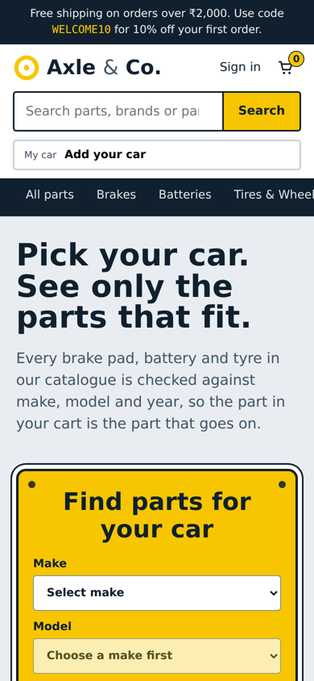

# Project Report: Axle & Co., an E-commerce Website for Automotive Parts

**Internship:** Full Stack Internship Projects by UCT
**Project:** 3) E-commerce website for automotive parts
**Intern:** JEET SHAW
**Code:** this repository (see [README.md](README.md) to run it)

---

## 1. About the company (UCT)

UCT runs a Full Stack internship programme in which each intern builds a complete project and delivers the code and a report on GitHub. The programme's project scope follows the current scenario, industrial demand and the projects running inside the company, and is divided into areas such as a blog CMS, a multi-client services marketplace, an automotive-parts e-commerce site, and food and grocery delivery applications.

I chose the **automotive parts e-commerce** project. Its deliverables, as set by UCT, are the code on GitHub and this project report covering the company, the background of the project, the problem statement and its relevance, the design, the implementation details, the results and my learnings.

## 2. Background of the project

Buying a car part online is harder than buying most products. A brake pad, a battery or a tyre only works if it matches the car's make, model, year and sometimes engine. A wrong order means a return, a delayed repair and an unhappy customer. General-purpose shops list parts by name and leave the shopper to work out compatibility.

The brief asks for a standard e-commerce site for **automotive parts and accessories** (brake pads, batteries, tyres, engine parts, lights, electronics, tools and more) with:

- browsing by make/model or by category,
- product specifications, images, reviews, related or alternate parts and availability,
- an intelligent search,
- a cart that persists across sessions,
- shipping and billing details and payment through a processor such as Stripe,
- order confirmation emails with order details and tracking,
- customer accounts with order history,
- an admin interface for products, inventory, order processing, customer service, marketing and sales reporting,
- new arrivals and promotions, SEO, ads and affiliate programmes,
- integrations with suppliers, drop-shippers and logistics services.

I named the store **Axle & Co.** and built it as a working end-to-end system rather than a set of mock pages.

## 3. Problem statement and relevance

**Problem.** Build an online store where a car owner can quickly find the right part for their own vehicle, pay securely, and follow the order to delivery, while the store owner can run inventory, orders and promotions without touching the database.

**Why it matters.**

1. *Fitment is the core business risk.* Wrong-part returns are the most expensive failure in auto-parts retail. Making "does it fit my car?" the first question, and answering it on every page, targets that risk directly.
2. *Search quality decides conversion.* Customers type "tyre", "bulb" or a part number printed on the old part. A search that understands these words finds the product; one that only matches exact titles loses the sale.
3. *Money and stock must be correct.* Totals computed in the browser can be tampered with, and two shoppers can buy the last unit at the same moment. The system has to be right under those conditions.
4. *The shop has to be operable.* A store is only useful if staff can add products, correct stock, ship orders with tracking and see sales, which is why the admin area is part of the scope and not an afterthought.

## 4. Requirements traceability

Every requirement in the brief and where it is implemented:

| Requirement from the brief | Implementation |
|---|---|
| Browse by make/model or category | Make → model → year selector (`FitmentPicker`), saved as "My car"; category navigation; filters by brand, price, stock, sale, new |
| Product specs, images, reviews, related/alternate parts, availability | Product page: spec table, image, verified-buyer reviews with average rating, alternate parts, "customers also bought", stock status ("In stock", "Only 3 left", "Out of stock") |
| Intelligent search | FTS5 full-text index with stemming, prefix, synonyms, part numbers, ranking, type-ahead (section 6.3) |
| Cart that saves items persistently across sessions | `cart_items` table for signed-in users; guest cart in the browser merged on sign-in |
| Shipping and billing information; payment via a processor like Stripe | Validated address form; Stripe Checkout adapter; built-in sandbox gateway for development |
| Order confirmation emails with order details and tracking info | Receipt to customer, notification to merchant, shipped email with carrier and tracking number |
| Customer account with order history | Register/sign in, order list, order page with status timeline and tracking |
| Admin: product and inventory management | Product CRUD (incl. specs and fitment), stock editing, low-stock alerts, hide/show |
| Admin: order processing, customer service | Order list by status, step-by-step fulfilment, tracking numbers, cancellation with refund state |
| Admin: marketing and sales reporting | Dashboard (revenue, orders, average order, gross margin, daily chart, best sellers), sales CSV export, discount codes |
| New arrivals and promotions | "New" (last 30 days) and "Sale" badges, deals and new-arrivals rows, sale prices, discount codes |
| SEO, ads and affiliate programmes | Per-page title/description/canonical, Product JSON-LD, `sitemap.xml`, `robots.txt`; `?ref=` affiliate code stored on the order and in the sales CSV |
| Integrations with suppliers, drop-shippers, logistics | `suppliers` table (lead time, drop-ship flag), supplier stock-feed endpoint, carrier and tracking number on orders |
| Part recommendation, vehicle fitment lookup | Alternates and "also bought"; fitment lookup on every product page |

## 5. Design

### 5.1 Architecture



One Node process serves both the API and the built React app, which keeps deployment to a single container. The API is stateless apart from the database, so it can be scaled by moving the database to a server such as PostgreSQL (section 9).

### 5.2 Data model



There are 13 application tables plus one FTS5 virtual table. The decisions that shaped the schema:

- **Money is stored as integers** in the smallest unit (paise), never as floating point, so totals and discounts add up exactly.
- **Fitment is a year range per make and model** (`year_from`..`year_to`) instead of one row per year. A part can fit "Swift 2012–2018" and a different part "Swift 2019–2024". A `is_universal` flag covers parts such as tools and wipers.
- **Order items copy the name, SKU and unit price** at purchase time, so later price edits never rewrite history.
- **`order_events`** records every status change, which drives the customer's timeline.
- **Products are hidden, not deleted**, so past orders keep their references.

### 5.3 Checkout and payment flow



### 5.4 Key design decisions

| Decision | Reason |
|---|---|
| The server computes every price | The browser never sends a price or total. Discounts, shipping and GST are recalculated at checkout, so tampering is impossible. |
| Stock is reserved when the order is created, inside one transaction | The `UPDATE … WHERE stock >= qty` check makes the database refuse the second buyer of the last unit. Stock is released on payment failure, cancellation, or after 30 minutes unpaid. |
| Hosted payment page (Stripe Checkout) | Card numbers never touch the server, which keeps the system out of the heaviest card-data obligations. |
| Payment adapter with a sandbox mode | The project runs and can be demonstrated with no external account, and the same order code path serves both modes. |
| SQLite with FTS5 | No separate database or search server to install, yet real ranked full-text search. Fine for this catalogue size and easy to run for assessment. |
| App factory with injected database and config | Tests create a fresh in-memory app in milliseconds. |

### 5.5 User interface

The design brief I set myself was: *the first thing a visitor must do is say which car they drive.* The home page therefore opens with a yellow plate-style selector (a nod to Indian number plates) and the chosen car stays in the header as "My car". Everything else uses a quiet steel-grey and navy palette with hi-vis yellow reserved for the primary actions. Part numbers use a monospace face because they are data people copy and compare. The layout is responsive down to a phone, has visible keyboard focus, labels for every form field, and respects reduced-motion settings.

## 6. Implementation details

### 6.1 Technology stack

| Layer | Choice |
|---|---|
| Frontend | React 19, React Router, Vite, hand-written CSS |
| Backend | Node.js 22, Express, Zod (validation), Helmet (security headers), express-rate-limit |
| Database | SQLite via `better-sqlite3`, FTS5 full-text index |
| Auth | bcrypt password hashes, signed JWT (7 days) |
| Payments | Stripe SDK (Checkout Sessions) + built-in sandbox |
| Email | Nodemailer (SMTP or file outbox) |
| Tests | `node:test` for the API; Playwright (Chromium) for a browser walkthrough |
| Delivery | Dockerfile, GitHub Actions workflow |

### 6.2 Vehicle fitment

`GET /api/products?make=Hyundai&model=Creta&year=2018` adds this condition to the query:

```sql
p.is_universal = 1 OR EXISTS (
  SELECT 1 FROM product_fitment f
  WHERE f.product_id = p.id AND f.make = ? AND f.model = ? AND ? BETWEEN f.year_from AND f.year_to)
```

The same check powers the "Fits your Hyundai Creta 2018" banner on a product page. The seeded catalogue has 13 vehicle models (popular Indian-market cars) and, for example, splits Swift brake pads into 2012–2018 and 2019–2024 sets, so a 2016 Swift is shown only the first. Alternates for a vehicle-specific part come only from parts that fit the same vehicle.

### 6.3 Search

1. The query is split into words. Each word is expanded with synonyms (`tyre → tire`, `bulb → headlight, led`, `plug → spark`) and given a prefix wildcard (`bat*`).
2. Words are combined with AND. If that matches nothing, the query is relaxed to OR so a stray word never produces a blank page.
3. SQLite's `porter` tokenizer stems words (brakes ≈ brake). Part numbers and SKUs are indexed too, so searching `SR-CRT1F` returns that exact part first.
4. Results are ranked with `bm25`, weighting name, part number and SKU above the description, and in-stock parts are preferred.
5. The same ranking feeds the header's type-ahead list (keyboard navigable).

Triggers keep the index in step with product edits, which a test checks (renaming a product makes the new name searchable).

### 6.4 Cart, pricing and checkout

- Signed-in users: every change is an `UPSERT` on `cart_items`, so the cart follows the account across sessions and devices.
- Guests: the cart lives in `localStorage` and is merged on sign-in (`POST /api/cart/merge`, the larger quantity wins).
- `pricing.quote()` returns line items, discount, shipping, GST and any stock problems. The cart page, checkout page and order creation all use it, so what the shopper sees is what is charged.
- Shipping: standard (free above a configurable threshold) or express. Tax: configurable GST rate. Coupons: percentage off with minimum spend, expiry and an on/off switch.

### 6.5 Orders and fulfilment

Status flow: `pending_payment → paid → processing → shipped → delivered`, with `cancelled` reachable before shipping. The admin can only move an order one step forward, and "shipped" requires a carrier and a tracking number, which are emailed to the customer and shown on the order page. Cancelling restores stock and marks the payment `refunded` (sandbox) or `refund_pending` (Stripe, to be refunded from the Stripe dashboard).

### 6.6 Admin area

Five sections: Dashboard, Orders, Products, Inventory & suppliers, Promotions. The supplier feed endpoint (`POST /api/admin/suppliers/:id/sync`) accepts `[{sku, stock, costCents}]`, updates only that supplier's products and reports unknown SKUs. In production this is what a scheduled job or a supplier webhook would call.

### 6.7 Security

- Passwords hashed with bcrypt; login and register rate-limited.
- Every request body is validated with Zod; SQL uses prepared statements throughout.
- Role checks on all admin routes; customers can read only their own orders (admins can read all).
- Helmet headers with a content-security policy; React escapes output; email templates escape user text.
- Only the last four digits of a card are ever stored, and only in sandbox mode.
- `JWT_SECRET` is mandatory in production.

### 6.8 Testing

- **27 automated API tests** (all passing) with an in-memory database. They include the fitment-by-year rule, synonym/part-number/prefix search, search-index updates, guest-cart merge, pricing arithmetic, successful and declined payments (stock is returned on failure), two shoppers racing for the last unit (exactly one succeeds), cross-customer access denied, cancellation and refund, the full fulfilment flow, verified-buyer-only reviews, admin CRUD and permissions, supplier sync, abandoned-order expiry, and the Stripe path using a stubbed gateway.
- **A 15-step browser walkthrough** in Chromium: pick a car → fitment-filtered shop → search "tyre" → fit verdict → cart → coupon → sign-in → address validation → declined card → successful payment → order history → admin ships the order with tracking → admin adds a product → customer sees the tracking number → mobile layout without horizontal scrolling.

## 7. Results

### 7.1 Screenshots

| | |
|---|---|
| **Home with the fitment plate**  | **Shop filtered to "My car"**  |
| **Product page with fit verdict**  | **Checkout**  |
| **Order confirmation and timeline**  | **Admin dashboard**  |
| **Admin order fulfilment**  | **Mobile home**  |

### 7.2 Measurements

Measured on one development machine with 160 products, 200 sequential requests per endpoint:

| Endpoint | Median | 95th percentile |
|---|---|---|
| Product list (12 items) | 1.6 ms | 6.1 ms |
| Search "brake" | 1.6 ms | 6.0 ms |
| Search "tyre" filtered to Creta 2018 | 1.5 ms | 4.0 ms |
| Product detail | 1.1 ms | 4.2 ms |
| Type-ahead "oil" | 1.2 ms | 3.3 ms |

These are localhost figures without network latency or concurrent load, so they show the queries are cheap, not how a deployed site would perform.

### 7.3 Outcome

All requirements in section 4 are implemented and exercised by tests. The seeded demo contains 159 products in 9 categories, 13 vehicle models with 174 fitment rules, 3 suppliers, 28 historical orders and 29 reviews, so every screen can be demonstrated immediately.

## 8. Learnings

1. **Fitment is a data-modelling problem first.** Storing year ranges per make and model made both the filter and the "does it fit?" banner a single query, and made generation-specific parts natural. One row per vehicle-year would have exploded the table.
2. **Never trust the browser with money.** Moving all pricing into one server function that the cart, checkout and order creation share removed a whole class of bugs and made tests simple.
3. **Concurrency needs the database's help.** A "check stock, then decrement" in application code is a race. Doing the check inside the `UPDATE … WHERE stock >= qty` statement, in a transaction, made the last-unit test pass reliably.
4. **Test through the real UI, not only the API.** The browser walkthrough found a bug the API tests could not: after a successful payment I cleared the cart, which triggered the checkout page's "cart is empty" redirect and sent the customer to the cart instead of the order page. It also found misleading "alternative parts" (other cars' pads), form errors that stayed after being fixed, and a header that broke on a phone.
5. **Design for the failure paths.** A declined card, a payment session that never starts, and an abandoned checkout all have to give the stock back and tell the user clearly what happened. Writing those tests first changed how I structured the order service.
6. **Keep external services behind an adapter.** The sandbox gateway let me build and test the whole purchase flow without an account, and a stubbed Stripe session tested the real-gateway path.
7. **Accessibility and mobile are part of "done".** Labels, focus states, keyboard-navigable search suggestions and a responsive header were cheap to include early and costly to retrofit.

## 9. Limitations and future work

- **Stripe was tested against a stub, not live.** The code follows Stripe's Checkout Session API, but it should be run once with a test key and a webhook before production. Refunds of Stripe payments are marked `refund_pending` and are not yet issued through the API.
- **Single-node database.** SQLite suits this scale and a single server; a larger deployment would move to PostgreSQL with a managed search index.
- **Catalogue data is fictional**, with illustrative category images instead of product photos and no image upload in the admin.
- **Search tolerates synonyms and prefixes but not arbitrary misspellings**; fuzzy matching (trigrams) would be the next step.
- **JWT is kept in `localStorage`** for simplicity; httpOnly cookies with CSRF protection would be stronger.
- **Not included:** email verification and password reset, guest checkout, saved multiple addresses, invoices, real carrier-rate and tracking APIs, and ad-platform feeds. Carriers and tracking numbers are entered by staff.

## 10. How to run

See [README.md](README.md). In short: `npm run install:all && npm run build && npm start`, then open <http://localhost:5000>. Demo logins: customer `demo@axleandco.test / Demo@1234`, admin `admin@axleandco.test / Admin@123`.
